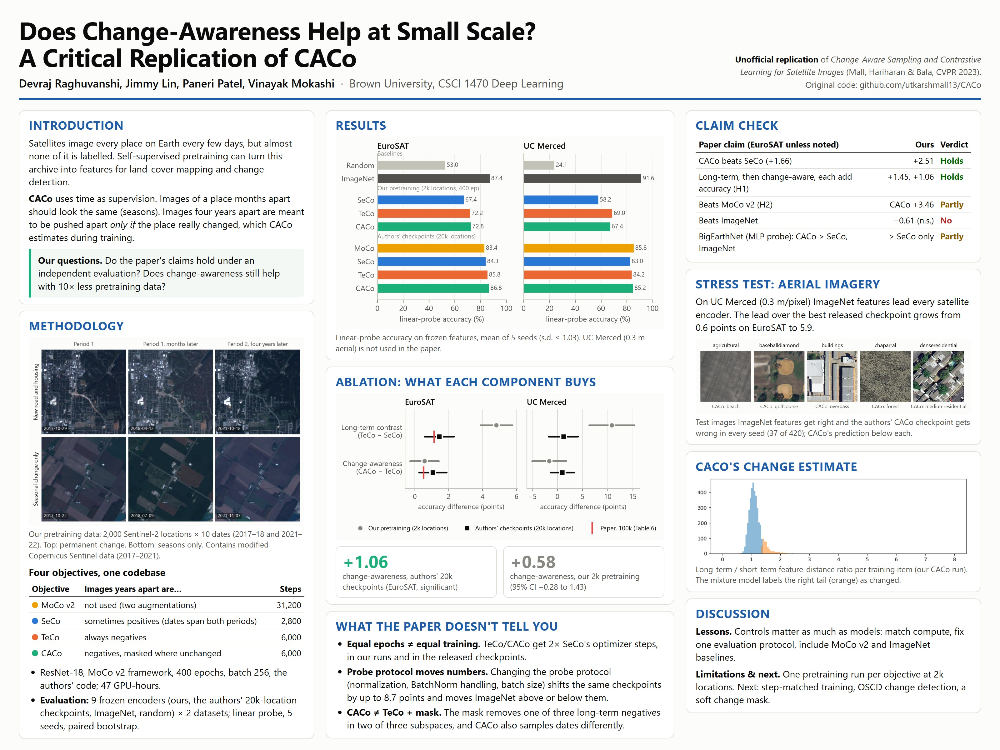
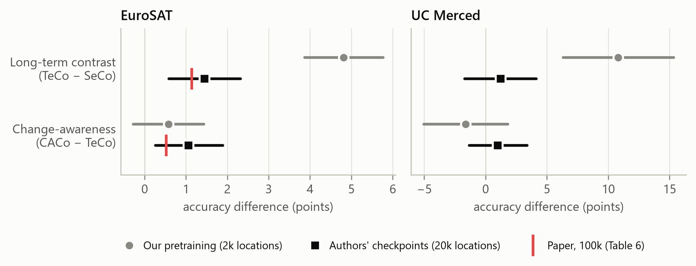
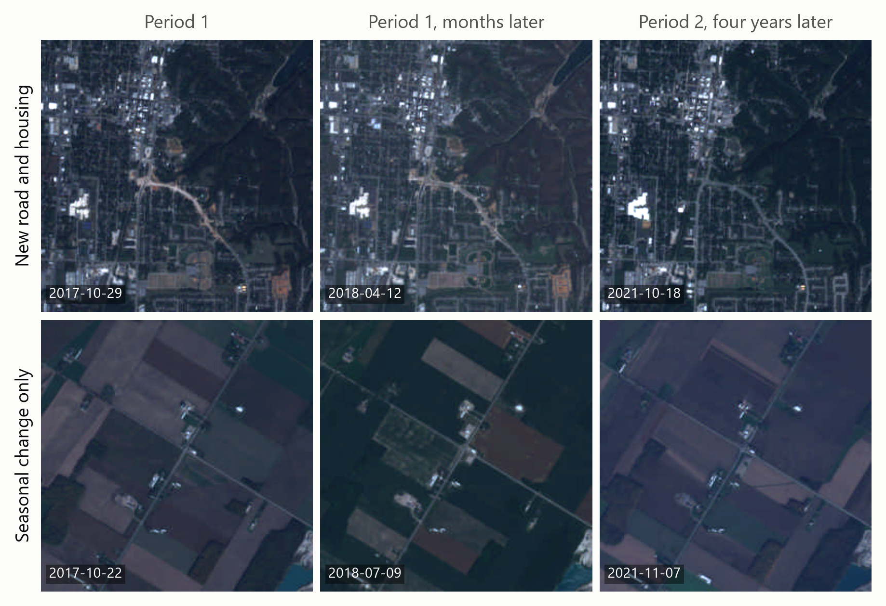

<h1 align="center">Season or Change?</h1>

<p align="center">
  <b>Does change-aware contrastive learning help satellite imagery at small scale?</b><br>
  An independent study of CACo (Mall, Hariharan &amp; Bala, CVPR 2023)
</p>

<p align="center">
  <a href="LICENSE"></a>
  
  
  <a href="report/main.pdf"></a>
  <a href="poster/poster.jpg"></a>
  <a href="https://github.com/VinayakMokashi/season-or-change/releases/tag/v1.0"></a>
</p>

<p align="center">
  Devraj Raghuvanshi · Jimmy Lin · Paneri Patel · Vinayak Mokashi<br>
  Brown University, CSCI 1470 Deep Learning
</p>

> **Unofficial, not affiliated with the CACo authors.** The method, reference code
> and pretraining data are theirs: [utkarshmall13/CACo](https://github.com/utkarshmall13/CACo).



## Overview

Satellites photograph every place on Earth every few days, but almost none of the
imagery is labelled. CACo learns features from it with a contrastive loss built on
time:

- images of a place taken months apart should look the same (seasons);
- images taken years apart should look different, but only where the place really
  changed, which CACo estimates during training.

We pretrained four self-supervised objectives with the authors' code. We then
evaluated them alongside the authors' released checkpoints and ImageNet features,
all under one fixed protocol, on two datasets:

- EuroSAT;
- UC Merced, aerial imagery that the paper does not use.

We asked two questions:

- Do the paper's claims hold under an independent evaluation?
- Does change-awareness still help with ten times less pretraining data?

## Key findings

- **The paper's ablation reproduces with the authors' checkpoints.** On EuroSAT,
  SeCo < TeCo < CACo (84.3 → 85.8 → 86.8%). Both steps are significant, and both
  intervals contain the paper's increments.
- **Change-awareness gives no measurable gain at small scale.** On our
  2,000-location pretraining, CACo − TeCo is +0.6 [−0.3, 1.4] points on EuroSAT
  and −1.6 [−5.0, 1.8] on UC Merced.
- **Equal epochs are not equal training.** TeCo and CACo take twice SeCo's
  optimizer steps, both in our runs and in the released checkpoints. Our MoCo v2
  baseline had 5× the steps of TeCo and CACo. In our original evaluation it beat
  all three temporal objectives at our scale.
- **Satellite features transfer less well to aerial imagery.** On UC Merced
  (0.3 m/pixel), ImageNet features lead every satellite encoder. Their lead over
  the best released checkpoint grows from 0.6 points on EuroSAT to 5.9.
- **The probe protocol moves the numbers.** Changing the probe protocol (input
  normalization, BatchNorm handling, batch size) shifts the same checkpoints by up
  to 8.7 points on EuroSAT. It also changes whether ImageNet ranks above or below
  them.



## Results

Linear-probe accuracy (%) on frozen ResNet-18 features. Each value is the
final-epoch accuracy, mean ± s.d. over 5 probe seeds. Full tables and paired
bootstrap tests: [`results/probes/summary.md`](results/probes/summary.md).

| Encoder | Pretraining | EuroSAT | UC Merced |
|---|---|---:|---:|
| Random init | – | 53.00 ± 0.13 | 24.14 ± 1.03 |
| ImageNet (supervised) | ImageNet-1k | **87.45 ± 0.04** | **91.62 ± 0.20** |
| SeCo | ours, 2k locations | 67.42 ± 0.05 | 58.24 ± 0.80 |
| TeCo | ours, 2k locations | 72.23 ± 0.06 | 69.05 ± 0.41 |
| CACo | ours, 2k locations | 72.81 ± 0.17 | 67.43 ± 0.68 |
| MoCo v2 | authors, 20k locations | 83.37 ± 0.03 | 85.76 ± 0.39 |
| SeCo | authors, 20k locations | 84.32 ± 0.04 | 82.95 ± 0.49 |
| TeCo | authors, 20k locations | 85.77 ± 0.06 | 84.19 ± 0.27 |
| CACo | authors, 20k locations | 86.83 ± 0.08 | 85.19 ± 0.35 |

- **"Ours"** are encoders we pretrained with the authors' code (400 epochs, one
  GPU each).
- **"Authors"** are the checkpoints released with the paper.
- **Our MoCo v2 encoder** was measured in our original single-seed evaluation
  (EuroSAT 79.48%). Those results are in
  [`results/original_eval/`](results/original_eval).
- **A BigEarthNet probe** of the released checkpoints is in
  [`results/earlier_runs/`](results/earlier_runs).

### Claims checked

| Claim from the paper | Paper | Ours (authors' checkpoints) | Verdict |
|---|---|---|---|
| CACo improves on SeCo (EuroSAT) | +1.66 (Tab. 6)¹ | +2.51 [1.64, 3.39] | Holds |
| Long-term contrast, then change-awareness, each add accuracy | +1.14, +0.52 | +1.45 [0.59, 2.32], +1.06 [0.26, 1.89] | Holds |
| Satellite objectives beat MoCo v2 | 87.22 < 90.05, 93.08 | CACo +3.46 [2.49, 4.44]; SeCo +0.94 [−0.05, 1.95] | Partly |
| Satellite pretraining beats ImageNet (EuroSAT) | 86.16 < 93.08 | ImageNet +0.61 [−0.37, 1.61] | Not reproduced |
| CACo beats SeCo and ImageNet on BigEarthNet (10% labels) | 67.89 > 65.80, 65.43 | CACo 63.18 > SeCo 60.57; ImageNet 66.17 (MLP probe, one run) | Partly |

¹ SeCo with CACo's geographic sampling, which we take to match the released
`_geo_` checkpoints (an inference from their file names). Table 1 of the paper
reports +3.03 against SeCo's original sampling.

The hypotheses and their decision rules are in
[`docs/HYPOTHESES.md`](docs/HYPOTHESES.md).



## How to run

Evaluation and analysis run on a laptop CPU; only pretraining needs a GPU. All
commands are run from the repository root.

### 1. Install

```bash
git clone https://github.com/VinayakMokashi/season-or-change.git
cd season-or-change
python -m venv .venv
source .venv/bin/activate            # Windows: .venv\Scripts\activate
pip install torch torchvision --index-url https://download.pytorch.org/whl/cpu   # or the CUDA build
pip install -r requirements.txt
```

### 2. Download data and pretrained weights

```bash
python scripts/download.py
```

This downloads about 0.8 GB into `data/` and `checkpoints/` (both git-ignored):

- EuroSAT with the SeCo/CACo splits;
- UC Merced;
- our three encoders, from the [v1.0 release](https://github.com/VinayakMokashi/season-or-change/releases/tag/v1.0);
- the four CACo authors' checkpoints.

Every encoder is checked against its SHA-256 hash.

### 3. Evaluate the encoders

```bash
python src/probe/run_probes.py --dataset eurosat  --data_dir data/eurosat/EuroSAT_RGB
python src/probe/run_probes.py --dataset ucmerced --data_dir data/ucmerced/UCMerced_LandUse/Images
```

This probes nine encoders on each dataset: random, ImageNet, our SeCo, TeCo and
CACo, and the authors' MoCo v2, SeCo, TeCo and CACo. For each encoder it trains a
linear probe with five seeds and computes k-NN and retrieval scores. The full
sweep takes under an hour on a CPU.

The results go to `results/probes/<dataset>/`: one JSON summary and one file of
per-image predictions per encoder. Use `--backbones caco-10k imagenet` to run a
subset.

### 4. Regenerate the tables and figures

```bash
python src/analysis/probes.py              # summary tables, paired bootstrap tests, hypotheses, figures
python src/analysis/pretraining.py         # loss curves from results/pretraining/
python src/analysis/failure_examples.py    # UC Merced failure cases
python src/analysis/pretraining_examples.py  # pretraining image examples (streams ~25 MB)
```

### 5. Use a pretrained encoder in your own code

```python
import torch
from torch import nn
from torchvision.models import resnet18

encoder = nn.Sequential(*list(resnet18().children())[:-1], nn.Flatten())
encoder.load_state_dict(torch.load('checkpoints/ours_10k/resnet18_caco_geo_10k_400.pth', map_location='cpu'))
encoder.eval()

features = encoder(torch.rand(8, 3, 64, 64))   # RGB in [0, 1] -> (8, 512) features
```

### 6. Pretrain from scratch (GPU)

The reference code needs its original environment (Python 3.9, PyTorch 1.7,
PyTorch Lightning 1.1.8); see [`requirements-pretrain.txt`](requirements-pretrain.txt).

```bash
python scripts/download.py --pretrain      # 2,000 locations x 10 Sentinel-2 dates (1.5 GB)
bash scripts/pretrain.sh caco              # or: seco, teco, moco
```

Each run logs per-epoch metrics and exports a plain ResNet-18 encoder. For
reference, training took 4.6 to 23.9 GPU-hours per objective.
[`docs/REPRODUCE.md`](docs/REPRODUCE.md) covers every step in detail, including
the BigEarthNet and Colab probes.

## Pretrained weights

| File | Objective | Download |
|---|---|---|
| `resnet18_seco_geo_10k_400.pth` | SeCo | [GitHub release](https://github.com/VinayakMokashi/season-or-change/releases/download/v1.0/resnet18_seco_geo_10k_400.pth) |
| `resnet18_teco_geo_10k_400.pth` | TeCo | [GitHub release](https://github.com/VinayakMokashi/season-or-change/releases/download/v1.0/resnet18_teco_geo_10k_400.pth) |
| `resnet18_caco_geo_10k_400.pth` | CACo | [GitHub release](https://github.com/VinayakMokashi/season-or-change/releases/download/v1.0/resnet18_caco_geo_10k_400.pth) |

- **What they are:** ResNet-18 encoders, 400 epochs on 2,000 Sentinel-2
  locations, about 43 MB each.
- **Mirror:** the same files are on
  [Google Drive](https://drive.google.com/drive/folders/1--bZxzBoeUYKOH7TfrxEeI06rUeX1Qj5).
- **Authors' checkpoints:** the CACo authors' 100k checkpoints are at
  <https://research.cs.cornell.edu/caco/checkpoints/>.
- **Details and hashes:** see [`docs/WEIGHTS.md`](docs/WEIGHTS.md).

## Repository layout

```
├── src/
│   ├── pretrain/train.py        # wrapper around the reference code: logging, checkpoints, export
│   ├── probe/                   # frozen-feature evaluation (datasets, backbones, run_probes.py)
│   └── analysis/                # tables, statistics and figures
├── experiments/                 # BigEarthNet and Colab probes of the released checkpoints
├── scripts/                     # download.py (data + weights), pretrain.sh
├── results/                     # probe sweep, original evaluation, earlier runs, pretraining logs
├── splits/                      # UC Merced train/test split
├── figures/  report/  poster/
├── docs/                        # HYPOTHESES.md, REPRODUCE.md, WEIGHTS.md
└── third_party/caco_upstream/   # the authors' code, unmodified (MIT)
```

All tables and figures are produced by the scripts in `src/analysis/`. The one
exception is the change-ratio histogram, which comes from the reference code's
training callback (see [`docs/REPRODUCE.md`](docs/REPRODUCE.md)).

## Credits and license

- **Method, reference code, pretraining data and released checkpoints:** Utkarsh
  Mall, Bharath Hariharan and Kavita Bala
  ([CACo](https://github.com/utkarshmall13/CACo), MIT License). The vendored copy
  in `third_party/caco_upstream/` keeps their license. Their code builds on
  [SeCo](https://github.com/ServiceNow/seasonal-contrast).
- **Datasets:**
  - [EuroSAT](https://github.com/phelber/EuroSAT)
  - UC Merced Land Use (Yang & Newsam, 2010), via the
    [TorchGeo mirror](https://huggingface.co/datasets/torchgeo/ucmerced)
  - [BigEarthNet](https://bigearth.net/)

  Figures contain modified Copernicus Sentinel data (2017–2021).
- **Course:** thanks to Prof. Randall Balestriero, our mentor TA Daniel Zhu and
  the CSCI 1470 staff. Pretraining ran on Brown's Center for Computation and
  Visualization (CCV).
- **License:** our code is under the [MIT License](LICENSE).

## Citation

If this study is useful to you, please cite it (see [`CITATION.cff`](CITATION.cff))
and the original paper:

```bibtex
@inproceedings{mall2023caco,
  title     = {Change-Aware Sampling and Contrastive Learning for Satellite Images},
  author    = {Mall, Utkarsh and Hariharan, Bharath and Bala, Kavita},
  booktitle = {CVPR},
  year      = {2023}
}
```
